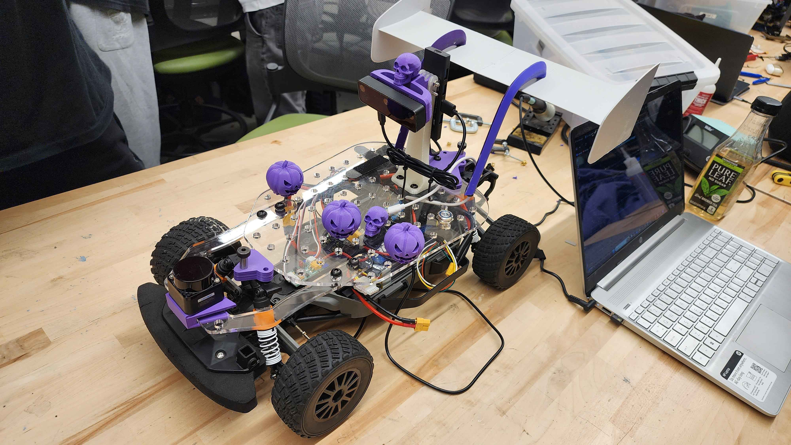

# ReaperBOT

### UC San Diego — ECE 148 Autonomous Vehicles

Welcome to the official documentation website for **Team 03, THE REAPER**.

Our project focuses on developing an autonomous robotic vehicle using computer vision, machine learning, and ROS 2.

## Project Overview

ReaperBOT is an autonomous RC car platform developed as part of UC San Diego's ECE 148 course.

Our work includes:

- **Hardware Integration:** Raspberry Pi, motor controllers, cameras, and RC communication.
- **Autonomous Driving:** DonkeyCar and machine learning models trained using collected driving data.
- **ROS 2 Development:** Robot control, sensor integration, and navigation.
- **Testing and Validation:** Track testing, performance analysis, and troubleshooting.

## Project Documentation

This website documents our engineering process, from initial setup through testing and final demonstrations.

We'll include technical explanations, code examples, wiring diagrams, training results, and videos of our RoboCar in action.

## Source Code

Visit our [GitHub repository](https://github.com/SpencerOK/ReaperBOT) to explore the project code and development history.
